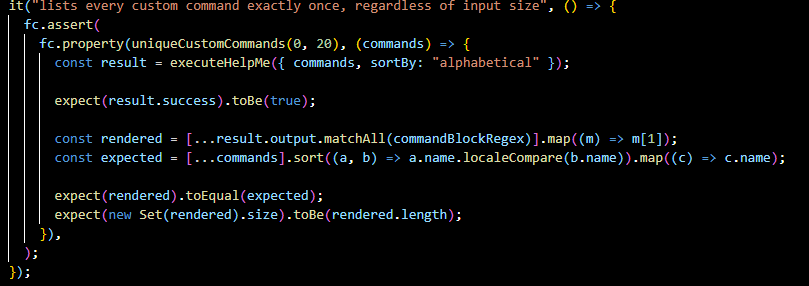

# Traceability: Billy McGrath (wpmcgrat)

**Target feature:** helpme, index.ts

## Requirements

| ID | Interview evidence | Requirement | Acceptance Criteria | Changed in P4? | Property (kind) | Test | Mutants it kills |
|---|---|---|---|---|---|---|
| R1 | S-7 “Some kind of report tool that could let you note that the output was not what the code does and something is wrong” | Add a report button to alert the model when a mistake is made and attempt to rectify it | A report button is present and will allow you to rerun the command with additional feedback provided to the model to correct its errors | No | Model/oracle | test 1 | H1 |
| R2 | C-2: “I think organizing the commands based on what they are being used for would be useful.” | Sort the results of the command to organize them by type or function | Results are listed either in alphabetical order, general type of command such as ones that only can read files vs write vs delete, or their scope and this can be controlled with additional keywords built on top of the base command | No | metamorphic | test 2 | none |
| R3 | O-2: “maybe it could explain basic functions in addition to custom functions like comprehensive descriptions of general stuff” | Explain basic functions too | All basic, non-custom functions are listed accurately in the results of the command consistently regardless of how many times you rerun the command | no | Invariant | not tested, instead a line was added to the normal function to point users towards the normal /help command for this purpose | none |
| R4 | O-6: “It could maybe have a source popup with the code to show what the command is doing and where it says that could be quite useful” | Show the source file of a function | When the command is run each of the commands listed also show what files their implementation comes from and what files it affects | no | Invariant | test 3 | H3, H4 |
| R5 | S-3: “It should show the new slash command and maybe it would be helpful to note it as a new slash command and what it does in some special way” | Mark new slash commands as new | In the output of the command it will display a highlight and the word “new” on the most recently created command since it was last run | no | metamorphic |test 4 | H5 |

Properties written or suggested by opencode or another AI tool: All properties themselves were written by me but the property based tests for R1, R2, R4, and R5 were written with help from gemini

## Requirement changes

| ID | Original requirement (P3) | Revised requirement | Why it changed |
|---|---|---|---|

## Hand Written Mutants
| ID | Requirement Targeted | change | predicted killer | Actual Result |
| H1 | R1 | removed the part of the report function that actually gives back the updated version but kept the part that sends the report that something was wrong | R1: should incorporate report feedback and note correction attempts | Killed by R1 when the actual feedback from the report button wasnt sent even though the flag for the report being sent still worked |
| H2 | R2 | incorrectly spelled alphabetical as alphabeticl and type as tye| R2: should sort consistently based on keyword strategies | Survived: the changing of the words they were searching for did break the actual sorting but didnt error because it still gave a reasonable output, just not a correctly sorted one |
| H3 | R4 | made it so the source file given is always bun.lock instead of the correct source file | R4: should always list descriptions and source files for basic commands | Killed: R4 checked to make sure it was actually the source file listed with the command instead of a random file and caught the error |
| H4 | R4 | removed the bullet points from the command output making it just a wall of text | R4: should always list descriptions and source files for basic commands | Killed: R4 correctly checked the formatting and caught that it was not displaying correctly |
| H5 | R5 | removed the new tag from the command outputs so even when a command was just made it still displays with no special indicator | R5: should highlight items marked as the newest creation context | Killed: R5 checked for the new tags when a new command was made and killed the mutation |

## Stryker Comparison

Which of your hand-written mutants did Stryker never generate? Why not?

It did not generate H1 or H3 or any ones that change a specific value to a different specific value, I would assume this is because stryker does not have the ability to parse the project and understand the appropriateness of filling in different files as reference values so it just cant do that.

Which Stryker survivors would you never have thought of? Are any of them bugs a real developer might plausibly write?

I didnt think of the idea of changing a declared empty list to one with content that it starts out with instead of being empty, It is possible for this one to be written by a real developer, but frankly it would be caught very easily as a bug because it would be at the top of every output that the command gave so it would be obvious.

What does each approach find that the other doesn't?

The hand written approach is built assuming your program works and can also be specifically tailored to whatever the end product is meant to be, while the stryker tests are able to make way more and test them practically so you can see where holes you werent even aware of are, but it has the downside of potentially making changes that would never be relevant to whatever your specific project is so sometimes it can overtest.

## Agent Failure Case

the prompt was "make me a basic but fully functional set of property based tests for my "helpme" command which gives a list of custom commands in opencode"

It let the handwritten mutant H5 through as well as H4

this test is functionally a more vague version of my R2 and is not as relevant to the project itself as it tests for something that is already self selected out of inherently from the way the feature works being through the opencode agent and as such when following its prompt, it will not return a command more than once already.
(for some reason it wouldnt let me add in another image to show that my R2 is better than this property test but if you look at the stryker report you will see that all of the R2 related features mutations are killed as well as all of my own)